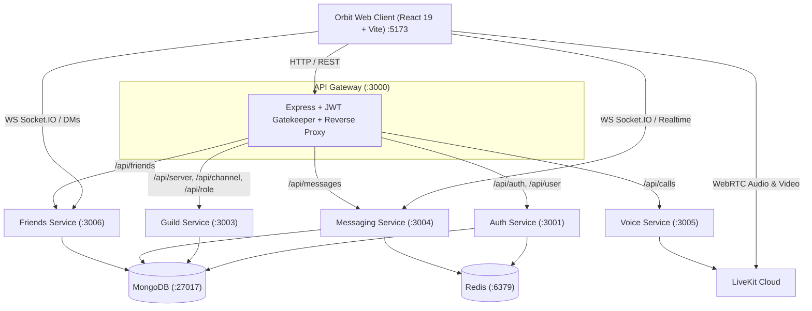

# Orbit — Discord Microservices Platform

Orbit is a modern, high-performance community chat and voice platform built on an asynchronous event-driven microservices architecture with a React 19 single-page application frontend.

---

## 🏛 Architecture Overview



---

## 📦 Services Breakdown

| Service | Port | Tech Stack | Responsibility |
| :--- | :--- | :--- | :--- |
| **`client`** | `5173` | React 19, Vite, Tailwind CSS, Redux Toolkit, TanStack Query, LiveKit Client | Web client interface, responsive chambers, live chat, lossless voice & screenshare. |
| **`api-gateway`** | `3000` | Express, `http-proxy-middleware`, JWT, Cookie-Parser | Single entrypoint, centralized JWT verification, routing to downstream microservices. |
| **`auth-service`** | `3001` | Express, Mongoose, Redis, Nodemailer, Passport Google OAuth2, ImageKit | User registration, login, JWT issuance, OTP email verification, token blacklisting. |
| **`guild-service`** | `3003` | Express, Mongoose, Multer, ImageKit | Server/Chamber creation, channel management (text/voice), role hierarchy & permissions. |
| **`messaging-service`**| `3004` | Express, Mongoose, Socket.IO, Redis | Channel messaging, message history persistence, socket authorization, token validation. |
| **`voice-service`** | `3005` | Express, LiveKit Server SDK | LiveKit WebRTC room token generation, active participant tracking per voice channel. |
| **`friends-service`** | `3006` | Express, Mongoose, Socket.IO | Direct messaging (DMs), friend requests, relationships, live DM socket events. |

---

## 🚀 Getting Started

### Prerequisites

- [Node.js](https://nodejs.org/) (v18 or higher)
- [Docker & Docker Compose](https://www.docker.com/) (recommended for local databases)
- [MongoDB](https://www.mongodb.com/) (local or cloud instance)
- [Redis](https://redis.io/) (local or cloud instance)
- [LiveKit Cloud Account](https://livekit.io/) (for voice channels)

---

### 1. Clone & Setup Databases

Run MongoDB and Redis using the root `docker-compose.yml`:

```bash
docker compose up -d mongo redis
```

---

### 2. Environment Configuration

Create a `.env` file in each service folder based on the templates below:

#### `services/api-gateway/.env`
```env
PORT=3000
JWT_SECRET=your_jwt_secret_here
AUTH_SERVICE_URL=http://localhost:3001
GUILD_SERVICE_URL=http://localhost:3003
MESSAGING_SERVICE_URL=http://localhost:3004
VOICE_SERVICE_URL=http://localhost:3005
FRIENDS_SERVICE_URL=http://localhost:3006
```

#### `services/auth-service/.env`
```env
PORT=3001
MONGO_URI=mongodb://localhost:27017/discord
REDIS_HOST=localhost
REDIS_PORT=6379
JWT_SECRET=your_jwt_secret_here
EMAIL_USER=your_email@gmail.com
EMAIL_PASS=your_email_app_password
IMAGEKIT_PUBLIC_KEY=your_imagekit_public_key
IMAGEKIT_PRIVATE_KEY=your_imagekit_private_key
IMAGEKIT_URL_ENDPOINT=your_imagekit_endpoint
```

#### `services/guild-service/.env`
```env
PORT=3003
MONGO_URI=mongodb://localhost:27017/discord
JWT_SECRET=your_jwt_secret_here
IMAGEKIT_PUBLIC_KEY=your_imagekit_public_key
IMAGEKIT_PRIVATE_KEY=your_imagekit_private_key
IMAGEKIT_URL_ENDPOINT=your_imagekit_endpoint
```

#### `services/messaging-service/.env`
```env
PORT=3004
MONGO_URI=mongodb://localhost:27017/discord
REDIS_HOST=localhost
REDIS_PORT=6379
JWT_SECRET=your_jwt_secret_here
GUILD_SERVICE_URL=http://localhost:3003
```

#### `services/voice-service/.env`
```env
PORT=3005
JWT_SECRET=your_jwt_secret_here
LIVEKIT_URL=wss://your-project.livekit.cloud
LIVEKIT_API_KEY=your_livekit_api_key
LIVEKIT_API_SECRET=your_livekit_api_secret
```

#### `services/friends-service/.env`
```env
PORT=3006
MONGO_URI=mongodb://localhost:27017/discord
JWT_SECRET=your_jwt_secret_here
```

---

### 3. Installation & Running Locally

Install dependencies for all services:

```bash
# Services
cd services/api-gateway && npm install && cd ../..
cd services/auth-service && npm install && cd ../..
cd services/guild-service && npm install && cd ../..
cd services/messaging-service && npm install && cd ../..
cd services/voice-service && npm install && cd ../..
cd services/friends-service && npm install && cd ../..

# Client
cd client && npm install && cd ..
```

Run each service in a separate terminal:

```bash
# Terminal 1: API Gateway
cd services/api-gateway && npm run dev

# Terminal 2: Auth Service
cd services/auth-service && npm run dev

# Terminal 3: Guild Service
cd services/guild-service && npm run dev

# Terminal 4: Messaging Service
cd services/messaging-service && npm run dev

# Terminal 5: Voice Service
cd services/voice-service && npm run dev

# Terminal 6: Friends Service
cd services/friends-service && npm run dev

# Terminal 7: Frontend Client
cd client && npm run dev
```

The frontend will be accessible at: `http://localhost:5173`

---

## 🐳 Running with Docker Compose

To start the entire platform (databases + all 6 microservices) with Docker:

```bash
docker compose up --build
```

---

## 🛠 Features

- **Authentication & Security**: Secure cookie-based JWT sessions, Redis token blacklisting on logout, email OTP verification.
- **Chambers & Guilds**: Sovereign chambers (servers), customizable text and voice channels, hierarchical roles and member permissions.
- **Real-Time Text Messaging**: WebSockets with Socket.IO, channel-specific rooms, optimistic updates, and persistent message history.
- **Studio-Grade Voice & Video**: WebRTC audio powered by LiveKit, mute/deafen controls, screen sharing, and live channel presence list.
- **Direct Messaging & Friends**: Real-time 1-on-1 direct conversations and friend request workflows.
- **Modern Responsive Interface**: High-aesthetic luxury gold/dark UI designed with Tailwind CSS, Redux state caching, and optimistic React Query synchronization.

---

## 📜 License

ISC
